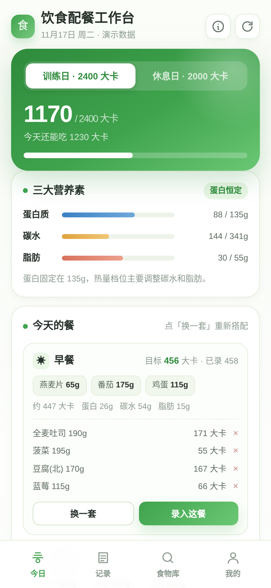
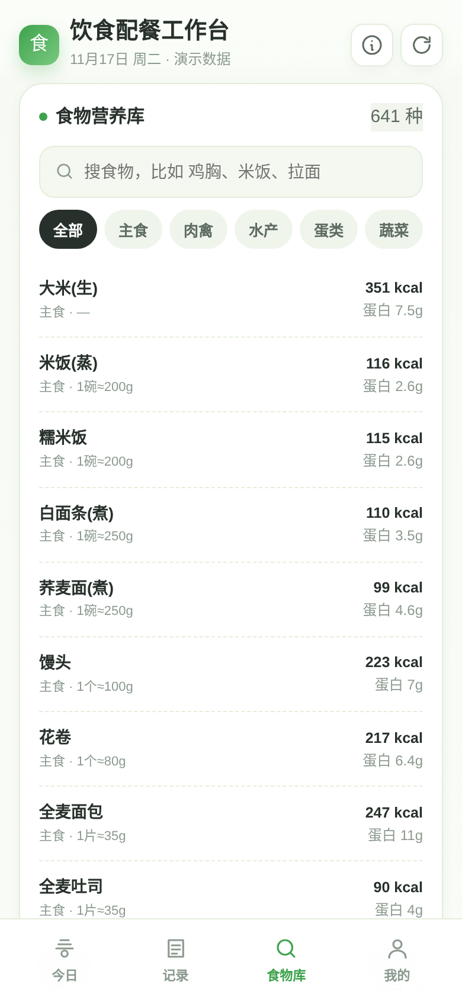
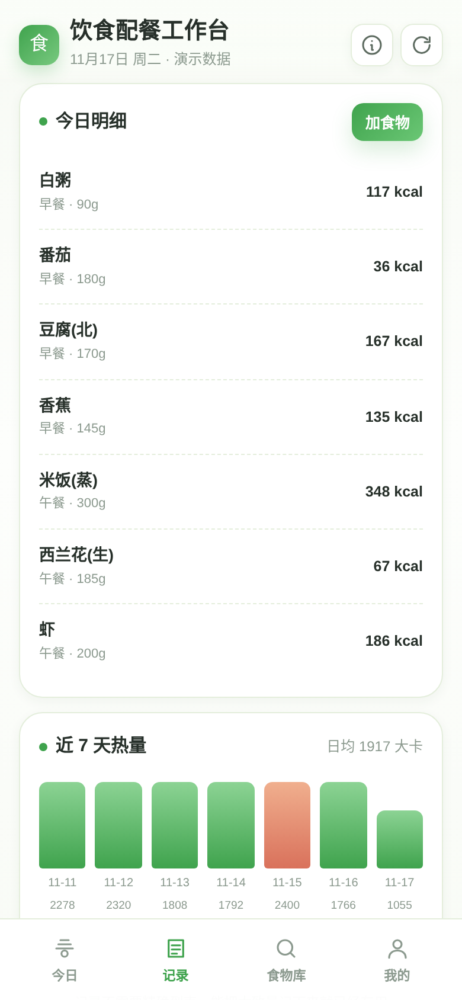

# 饮食配餐工作台

[](https://253631672.github.io/diet-planner-workbench/) [](diet-planner-workbench.html) [](#) [](LICENSE) [](#许可)

训练日和休息日两套热量，吃一顿剩余目标自动重算。

单文件 HTML，内含 641 条食物营养数据，双击就能用，不联网。





## 两档热量

| 档位 | 总热量 | 蛋白质 | 碳水 | 脂肪 |
|---|---|---|---|---|
| 训练日 | 2400 大卡 | 135g | 341g | 55g |
| 休息日 | 2000 大卡 | 135g | 241g | 55g |

蛋白质固定 135g，两档之间主要调碳水。训练日分四餐（早餐 19%、午餐 31%、练前 19%、练后 31%），休息日分三餐（22%、39%、39%）。这套数字适合体重 70 到 75 公斤、每周训练四到五次、目标是增肌的人，要改就在 `const TARGET=` 里改。

## 推荐怎么算

每餐不是随机抓几样，而是按角色凑：

1. 蔬菜固定 150 到 200g，早餐配番茄黄瓜，午晚配西兰花、生菜、菠菜
2. 蛋白质按这餐热量的 36% 取 80 到 200g
3. 水果按餐次给，练后必给香蕉
4. 主食补足剩下的热量，份量夹在 40 到 300g
5. 午晚餐加 6 到 10g 烹饪油，不然脂肪永远填不满

点「换一套」会从同一餐次的候选池里重排，不会把盖浇饭塞进早餐。

## 能做什么

- **今日**：热量环、三大营养素进度、四餐或三餐推荐，录入后剩余目标立刻重算
- **记录**：今日明细按餐次分组，近 7 天热量柱状图，超 2400 的那天标红
- **食物库**：641 条食物，支持搜索和分类筛选，覆盖主食、肉禽、水产、外卖成品
- **我的**：体重记录、导出与重置

## 怎么用

下载 `diet-planner-workbench.html`，双击打开。首次是演示数据，直接点「换一套」就能看到不同搭配。

## 数据在哪

localStorage，键名 `diet_planner_wb_v1`。不上传，清缓存会丢，用「我的」页导出备份。

## 已知限制

- 热量按每 100g 生重估算，熟米、煮熟面条已按熟重单列，但同一食材不同做法仍有偏差
- 不识别照片，不自动算份量，要自己称或估
- 营养数据用于日常记录，不作为医疗或营养处方

## 文件结构

```
diet-planner-workbench.html   程序本体，112KB（含 641 条营养数据）
screenshots/                  三张界面截图
LICENSE
```

如果这个工具帮你省了点时间，点个 Star 支持一下，也方便后面找到它。

## 许可

MIT。可自由使用、修改和商用，保留版权与许可声明即可，无需单独授权。
